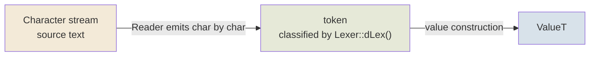
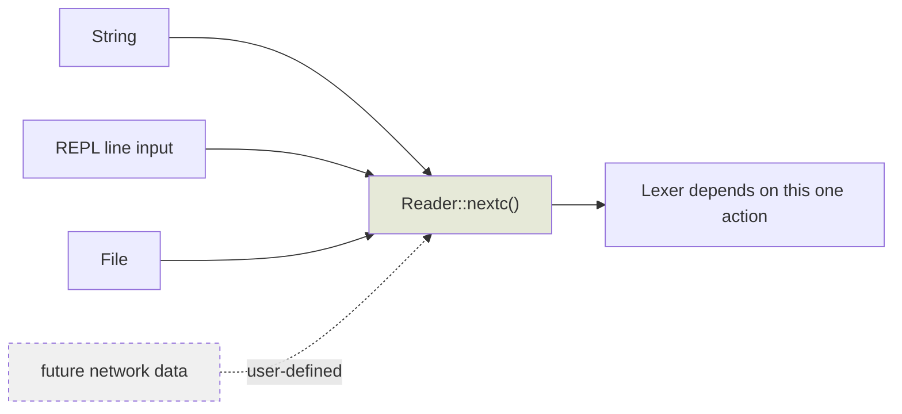
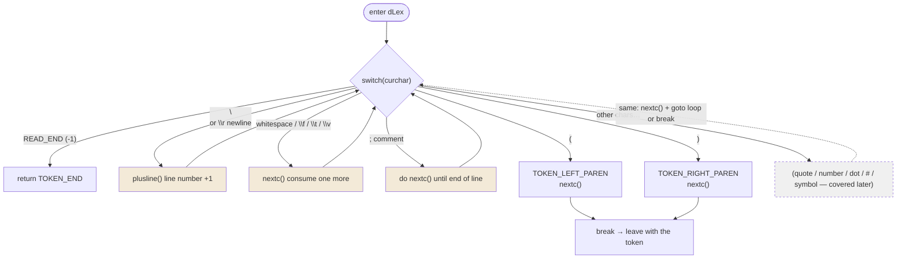
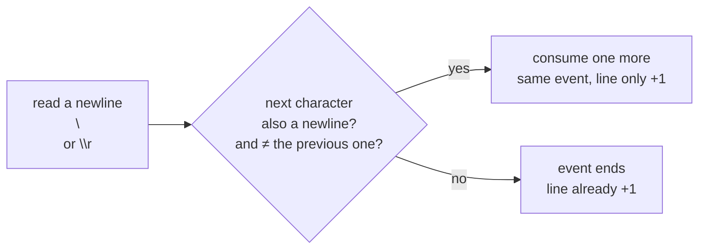

# Lexical Analysis 01

> The Tao that can be told is not the eternal Tao.
> The name that can be named is not the eternal name.
> The nameless is the beginning of heaven and earth.
> The named is the mother of ten thousand things.
> Ever desireless, one can see the mystery.
> Ever desiring, one can see the manifestations.
> These two spring from the same source but differ in name;
> this appears as darkness.
> Darkness within darkness. The gate to all mystery.
> — Lao Tzu, *Tao Te Ching*

---

Lexical analysis as a whole is a pipeline: characters come in, tokens come out, and a value is built in the end.

```
character stream --> token --> ValueT
```

Three stages, each with one lead:



---

## ValueT first

```
struct ValueT {
  ValueU v;
  byte t;
};
```
v is the union of all value types: primitive types (num, char, ...) and pointer types (ref).
```
union ValueU {
  RefPtr p;
  BasicNum num;
  uchar c;
};
union BasicNum {
  scm_int i; // integer
  double r; // real
};
struct RefObject {
  ...
  RefPtr gcnxt;
};
typedef RefObject* RefPtr;
typedef uchar scm_char;
typedef long scm_int;
```
`RefObject::gcnxt` exists for the GC: every object created with `new` is hung onto a singly-linked list through this field.

```
object A --gcnxt--> object B --gcnxt--> object C --gcnxt--> NULL
      ^                              ^
      └────── every heap object lives on this one list ──────┘
```

`ValueT::t` is the type tag; depending on the type it decides which field of `ValueU` is meaningful.

```
enum ValueTEnum {
  ...
  VT_NULL, // nil or null
  VT_NUM_INTEGER,
  VT_NUM_REAL,
  VT_CHAR,
  VT_REF,
  ...
};
```

This "type → field" correspondence is the lookup table the reader holds when constructing values:

| Type | Field used | What it holds |
|---|---|---|
| `VT_NUM_INTEGER` | `v.num.i` | integer |
| `VT_NUM_REAL` | `v.num.r` | real |
| `VT_CHAR` | `v.c` | character |
| `VT_REF` | `v.p` | reference (to an object on the GC list) |
| `...` | — | the rest, covered one by one in later articles |

Reading `#\a` puts a character into `v.c`; reading a number puts a number into `v.num`; reading `(quote ...)` puts a heap object into `v.p` — **t decides how to read, v decides what is read**.

---

## Character stream

Abstract a `Reader` type to support strings, REPL, files, and even user-defined network data.
```
class Reader {
public:
  virtual ~Reader() {}
  virtual int nextc() = 0;
  ...
};
```

`nextc()` asks one question: what is the next character? It doesn't care who the source is —



Strings, REPL, files, and network data that may come later — every input is abstracted into one action: **spit out the next character**. The lexer doesn't care whether a character was pulled from memory or gnawed off the disk.

Using a string as the example:

```
class ReaderS : public Reader {
public:
  ReaderS(const char* p): buff(p), n(0) {
    size = strlen(p);
  }

  virtual int nextc() { return n < size ? buff[n++] : -1; }
  ...

  const char* buff;
  int n;
  int size;
};
```
Taking `ReaderS` as the example: `ReaderS::size` is the length of `buff`, `ReaderS::n` is the next character to read (returning -1 marks the end), `ReaderS::buff` points at the string, and the external caller is responsible for its lifetime.
But the usual usage is
```
const char* p = "(define a 2)";
ReaderS s(p);
...
```
A local variable is all you need; no special care is required unless you go asynchronous — not a concern for now.

The three fields map exactly to "how much is left, where we are, who to read next":

```
buff ──► "(define a 2)"
          ↑      ↑
        n = 0    size = 11
        (next char to read)   (total length)
```

---

## Next up — the heart of it: character stream -> Token

A `Lexer` class works together with the `Reader` above to perform the lexical analysis.
```
class Lexer {
public:
  ...
  void nextc() { curchar = reader->nextc(); }
  int dLex();
  ...
  Reader* r;
  int curchar;
  ...
};
```
`Lexer::curchar` is the currently read character; `Lexer::dLex` uses it to decide what token type the current character is (int, string, symbol, char, ...).

`nextc()` is the mouth, `curchar` is the character held in the mouth, `dLex()` is the brain — it looks at `curchar` and decides how to classify it. About token types:
```
enum TokenType {
  TOKEN_UNKNOWN,
  TOKEN_END,
  ...
  TOKEN_DOT,
  ...
  TOKEN_LEFT_PAREN,
  TOKEN_RIGHT_PAREN,
  ...
  TOKEN_MAX,
};
```
For now we only care about `\(` `\)` and `\.`:

| token | Character | Meaning |
|---|---|---|
| `TOKEN_LEFT_PAREN` | `(` | list begins |
| `TOKEN_RIGHT_PAREN` | `)` | list ends |
| `TOKEN_DOT` | `.` | the dot in a dotted pair (`(a . b)`) |

The rest (numbers, strings, symbols, characters, ...) are just reserved in the `...`, to be covered one by one in later articles.

`Lexer::dLex` is one big switch-case.
```
int Lexer::dLex()
{
  int token = TOKEN_UNKNOWN;
 loop:
  switch(curchar) {
  case READ_END:
    return TOKEN_END;
  case '\n': case '\r':
    plusline();
    goto loop;
  case ' ': case '\f': case '\t': case '\v':
    nextc();
    goto loop;
  case ';':
    do {
      nextc();
    } while(curchar != READ_END && curchar != '\n' && curchar != '\r');
    goto loop;
  case '(':
    token = TOKEN_LEFT_PAREN;
    ...
    nextc();
    break;
  case ')':
	token = TOKEN_RIGHT_PAREN;
    nextc();
    break;
  }
}
#define READ_END -1
```
On `READ_END` (-1) it returns `TOKEN_END`; `;` is the Lisp/Scheme comment — everything from the current position to the end of the line is a comment.
For `(` and `)` it sets the token type, then reads one more character.
Non-newline whitespace keeps moving forward.

Walking this switch as a diagram makes the loop skeleton clear:



Note how three kinds of characters are treated differently:

- **Whitespace and comments**: produce no token, just "housekeeping". After handling, return to `loop` and look at the next character — they are transparent.
- **Newlines**: same as above, plus one extra thing — line number +1 (later error reports need line numbers).
- **`(` `)`**: produce tokens. Set the type, advance, `break` out of the switch, return with the token.

So the essence of dLex is: **skip meaningless characters in a loop, until you hit a meaningful one, cut it into a token and leave.**

Newlines deserve a special note — this is fun (borrowed from Lua):
```
void Lexer::plusline()
{
  ...
  int old = curchar;
  nextc();
  // \n\r or \r\n
  // not \n\n
  if ((curchar == '\n' || curchar == '\r') && curchar != old)
    nextc();
}
```
```
\r\n   -> line number +1
\n\r   -> line number +1
\n\n   -> line number +2
\r\r   -> line number +2
```



`\r\n` is **one** newline event (Windows files); `\n\r` is also **one** (old Mac), so both only +1;
`\n\n` is two separate events, +2. The check "the new character is also a newline and differs from the old one" — one line of code settles all three platforms.

## What's next

Any new token type is just another case added to the switch in `Lexer::dLex`.
