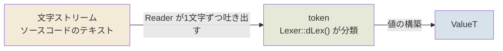
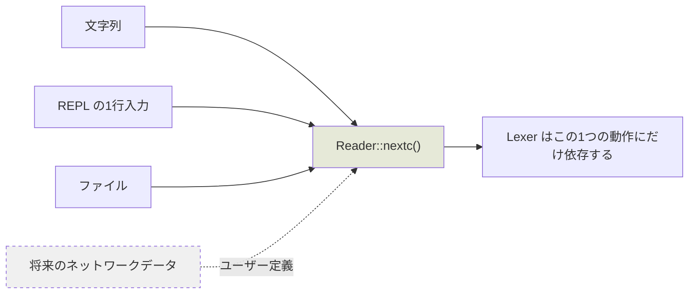
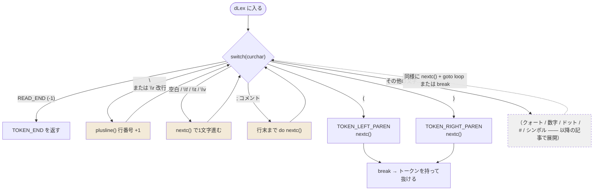
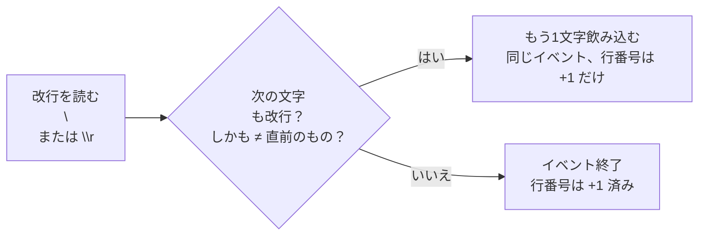

# 字句解析01

> 道の道とすべきは、常の道に非ず。
> 名の名とすべきは、常の名に非ず。
> 無は天地の始めを名づけ、
> 有は万物の母を名づく。
> 故に常に無にして、以てその妙を観んと欲し、
> 常に有にして、以てその徼を観んと欲す。
> 此の両者は、同じく出でて名を異にす。
> 同じく之を玄と謂う。
> 玄の又玄、衆妙の門。
> ——老子『道徳経』

---

字句解析は全体として一本のパイプラインだ。文字が入り、トークンが出て、最後に値になる。

```
文字ストリーム --> token --> ValueT
```

三つの段階に、それぞれ主役がいる：



---

## まず ValueT から

```
struct ValueT {
  ValueU v;
  byte t;
};
```
v は全型の union だ。基本型(num, char, ...)とポインタ型(ref)を格納する。
```
union ValueU {
  RefPtr p;
  BasicNum num;
  uchar c;
};
union BasicNum {
  scm_int i; // integer
  double r; // real
};
struct RefObject {
  ...
  RefPtr gcnxt;
};
typedef RefObject* RefPtr;
typedef uchar scm_char;
typedef long scm_int;
```
`RefObject::gcnxt` は GC 用だ。`new` したオブジェクトはすべてこのフィールドで片方向リストにつながれる。

```
オブジェクトA --gcnxt--> オブジェクトB --gcnxt--> オブジェクトC --gcnxt--> NULL
      ^                              ^
      └────── すべてのヒープオブジェクトがこの1本のチェーンに ──────┘
```

`ValueT::t` は型を表し、型に応じて `ValueU` のどのフィールドが意味を持つかを決める。

```
enum ValueTEnum {
  ...
  VT_NULL, // nil or null
  VT_NUM_INTEGER,
  VT_NUM_REAL,
  VT_CHAR,
  VT_REF,
  ...
};
```

この「型 → フィールド」の対応表こそ、読み取り器が値を構築するときに手にする照合表だ：

| 型 | 使うフィールド | 中身 |
|---|---|---|
| `VT_NUM_INTEGER` | `v.num.i` | 整数 |
| `VT_NUM_REAL` | `v.num.r` | 実数 |
| `VT_CHAR` | `v.c` | 文字 |
| `VT_REF` | `v.p` | 参照（GC チェーン上のオブジェクトを指す） |
| `...` | — | その他の型は以降の記事で一つずつ展開 |

`#\a` を読めば `v.c` に文字を入れ、数字を読めば `v.num` に数値を入れ、`(quote ...)` を読めば `v.p` にヒープオブジェクトを入れる——**t が読み方を決め、v が読む内容を決める**。

---

## 文字ストリーム

`Reader` 型を抽象化して、文字列、REPL、ファイル、さらにはユーザー定義のネットワークデータまでサポートする。
```
class Reader {
public:
  virtual ~Reader() {}
  virtual int nextc() = 0;
  ...
};
```

`nextc()` が問うのはただ一つ：次の文字は何か。出所は問わない——



文字列も REPL もファイルも、将来ありうるネットワークデータも、入力は一つの動作に抽象される：**次の文字を吐き出す**。字句解析器は、文字がメモリから取り出されたのか、ディスクから齧り取られたのかを気にしない。

文字列を例にしよう：

```
class ReaderS : public Reader {
public:
  ReaderS(const char* p): buff(p), n(0) {
    size = strlen(p);
  }

  virtual int nextc() { return n < size ? buff[n++] : -1; }
  ...

  const char* buff;
  int n;
  int size;
};
```
`ReaderS` を例にすると、`ReaderS::size` は `buff` の長さ、`ReaderS::n` は次に読む文字（-1 を返せば末尾）、`ReaderS::buff` は文字列を指し、その寿命は外部の呼び出し側が管理する。
ただし、使い方はだいたい次の通りだ：
```
const char* p = "(define a 2)";
ReaderS s(p);
...
```
ローカル変数一つで十分。特別気にする必要はない。非同期にする場合を除けば——今は考えなくていい。

三つのフィールドはちょうど「残りはいくつか、どこまで読んだか、次は誰を読むか」に対応する：

```
buff ──► "(define a 2)"
          ↑      ↑
        n = 0    size = 11
        （次に読む文字）   （全体の長さ）
```

---

## 次が本題：文字ストリーム -> Token

上の `Reader` と組み合わせて字句解析を行う `Lexer` クラスが必要だ。
```
class Lexer {
public:
  ...
  void nextc() { curchar = reader->nextc(); }
  int dLex();
  ...
  Reader* r;
  int curchar;
  ...
};
```
`Lexer::curchar` は現在読み取った文字だ。`Lexer::dLex` はそれを使って今の文字がどのトークン型か(int, string, symbol, char, ...)を判断する。

`nextc()` は口、`curchar` は口にくわえた文字、`dLex()` は頭脳——`curchar` を見てどう分類するかを決める。Token 型について：
```
enum TokenType {
  TOKEN_UNKNOWN,
  TOKEN_END,
  ...
  TOKEN_DOT,
  ...
  TOKEN_LEFT_PAREN,
  TOKEN_RIGHT_PAREN,
  ...
  TOKEN_MAX,
};
```
今は `\(` `\)` と `\.` だけ気にすればよい：

| token | 対応する文字 | 意味 |
|---|---|---|
| `TOKEN_LEFT_PAREN` | `(` | リストの開始 |
| `TOKEN_RIGHT_PAREN` | `)` | リストの終了 |
| `TOKEN_DOT` | `.` | ドット対のドット（`(a . b)`） |

残りの型（数字、文字列、シンボル、文字……）は `...` に予約しておき、以降の記事で一つずつ取り出す。

`Lexer::dLex` は巨大な switch case だ。
```
int Lexer::dLex()
{
  int token = TOKEN_UNKNOWN;
 loop:
  switch(curchar) {
  case READ_END:
    return TOKEN_END;
  case '\n': case '\r':
    plusline();
    goto loop;
  case ' ': case '\f': case '\t': case '\v':
    nextc();
    goto loop;
  case ';':
    do {
      nextc();
    } while(curchar != READ_END && curchar != '\n' && curchar != '\r');
    goto loop;
  case '(':
    token = TOKEN_LEFT_PAREN;
    ...
    nextc();
    break;
  case ')':
	token = TOKEN_RIGHT_PAREN;
    nextc();
    break;
  }
}
#define READ_END -1
```
`READ_END`(-1) に当たれば `TOKEN_END` を返す。`;` は Lisp/Scheme のコメントで、現在位置から行末までがコメント。
`(` と `)` はトークン型を設定してから一文字先に進む。
改行でない空白はそのまま先を探索する。

この switch を図にすると、ループの骨格がはっきりする：



三種類の文字の待遇の違いに注目しよう：

- **空白とコメント**：トークンを生まず、ただの「掃除」。処理後は `loop` に戻って次の文字を見る——透明だ。
- **改行**：同じだが、もう一つだけ違う——行番号 +1（後でエラー報告に行番号が要るから）。
- **`(` `)`**：トークンを生む。型を設定し、1文字進み、`break` で switch を抜けて、トークンを持って返る。

つまり dLex の本質は：**ループで意味のない文字を飛ばし、意味のある文字に当たったらトークンに切り出して去る。**

改行については特に説明が必要だ。面白い（Lua 参照）：
```
void Lexer::plusline()
{
  ...
  int old = curchar;
  nextc();
  // \n\r or \r\n
  // not \n\n
  if ((curchar == '\n' || curchar == '\r') && curchar != old)
    nextc();
}
```
```
\r\n   -> 行番号 +1
\n\r   -> 行番号 +1
\n\n   -> 行番号 +2
\r\r   -> 行番号 +2
```



`\r\n` は**一つの**改行イベント（Windows ファイル）、`\n\r` も**一つ**（古い Mac）。だからどちらも +1 だけ。
`\n\n` は独立した二つのイベントで +2。「新しい文字も改行で、かつ直前の文字と異なる」という判定——たった1行で、三つのプラットフォームを全部片付ける。

## 続き

新しい Token 型を足すのは、`Lexer::dLex` の switch に case を追加するだけだ。
