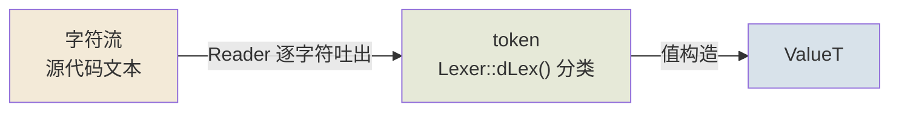
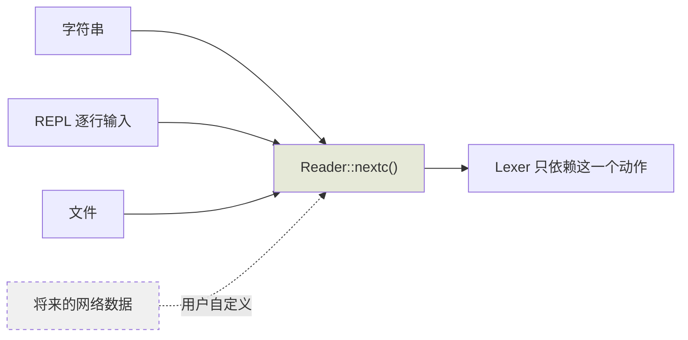
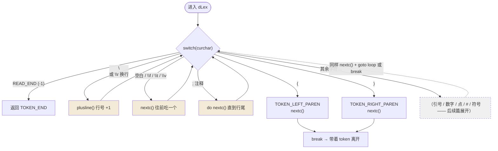
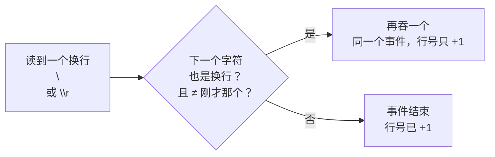

# 词法分析01

> 道可道，非常道。
> 名可名，非常名。
> 无，名天地之始。
> 有，名万物之母。
> 故常无，欲以观其妙；
> 常有，欲以观其徼。
> 此两者，同出而异名。
> 同谓之玄。
> 玄之又玄，众妙之门。
> ——老子《道德经》

---

整个词法分析就是一条流水线：字符进来，token 出去，最后落成值。


```
字符流 --> token --> ValueT
```

三个环节，各有一个主角：



---

## 先看ValueT

```
struct ValueT {
  ValueU v;
  byte t;
};
```
v 是所有类型的union, 基本类型(num, char, ...)，指针类型(ref)
```
union ValueU {
  RefPtr p;
  BasicNum num;
  uchar c;
};
union BasicNum {
  scm_int i; // integer
  double r; // real
};
struct RefObject {
  ...
  RefPtr gcnxt;
};
typedef RefObject* RefPtr;
typedef uchar scm_char;
typedef long scm_int;
```
RefObject::gcnxt是为了GC用的，所有new出来的对象都会通过这个字段用单向链表挂起来

```
对象A --gcnxt--> 对象B --gcnxt--> 对象C --gcnxt--> NULL
      ^                              ^
      └────── 所有堆对象都在这一条链上 ──────┘
```

ValueT::t表示类型，根据不同类型决定ValueU中哪个字段有意义

```
enum ValueTEnum {
  ...
  VT_NULL, // nil or null
  VT_NUM_INTEGER,
  VT_NUM_REAL,
  VT_CHAR,
  VT_REF,
  ...
};
```

这一"类型 → 字段"的对应关系，就是读取器构造值时手里拿的对照表：

| 类型 | 用哪个字段 | 装的是什么 |
|---|---|---|
| `VT_NUM_INTEGER` | `v.num.i` | 整数 |
| `VT_NUM_REAL` | `v.num.r` | 实数 |
| `VT_CHAR` | `v.c` | 字符 |
| `VT_REF` | `v.p` | 引用（指向 GC 链上的对象） |
| `...` | — | 其余类型，后续篇逐个展开 |

读到 `#\a` 就往 `v.c` 里放字符，读到数字就往 `v.num` 里放数，读到 `(quote ...)`
就往 `v.p` 里放一个堆对象——**t 决定怎么读，v 决定读什么**。

---

## 字符流

抽象一个Reader类型，用于支持字符串，REPL，文件，甚至用户自定义的网络数据
```
class Reader {
public:
  virtual ~Reader() {}
  virtual int nextc() = 0;
  ...
};
```

`nextc()` 就一个问题：下一个字符是什么？来源是谁，它不管——



字符串、REPL、文件、将来可能有的网络数据，输入都被抽象成一个动作：
**吐下一个字符**。词法分析器不关心字符是从内存里摸出来的，还是从磁盘上啃下来的。

以字符串为例：

```
class ReaderS : public Reader {
public:
  ReaderS(const char* p): buff(p), n(0) {
    size = strlen(p);
  }

  virtual int nextc() { return n < size ? buff[n++] : -1; }
  ...

  const char* buff;
  int n;
  int size;
};
```
以ReaderS为例，ReaderS::size是buff的长度，ReaderS::n下一个要读的字符，返回-1表示末尾，
ReaderS::buff指向字符串，外部调用方需要负责它的生命周期。
不过使用过程一般是
```
const char* p = "(define a 2)";
ReaderS s(p);
...
```
一个局部变量即可，不需要特别在意，除非要做异步，现在不用考虑。

三个字段正好对应"还剩多少、读到哪了、下次读谁"：

```
buff ──► "(define a 2)"
          ↑      ↑
        n = 0    size = 11
        （下一个要读的字符）   （总共这么长）
```

---

## 接下来重中之重，字符流 -> Token

需要借助一个类Lexer配合上面的Reader来完成词法分析
```
class Lexer {
public:
  ...
  void nextc() { curchar = reader->nextc(); }
  int dLex();
  ...
  Reader* r;
  int curchar;
  ...
};
```
Lexer::curchar是当前读到的字符，Lexer::dLex需要用它判断当前是什么token类型(int, string, symbol, char, ...)。

`nextc()` 是嘴巴，`curchar` 是嘴里叼着的那个字符，`dLex()` 是大脑——看着 `curchar`
决定把它归类成什么。关于Token类型
```
enum TokenType {
  TOKEN_UNKNOWN,
  TOKEN_END,
  ...
  TOKEN_DOT,
  ...
  TOKEN_LEFT_PAREN,
  TOKEN_RIGHT_PAREN,
  ...
  TOKEN_MAX,
};
```
当前只需要关心`\(` `\)` 还有 `\.` 即可：

| token | 对应字符 | 含义 |
|---|---|---|
| `TOKEN_LEFT_PAREN` | `(` | 列表开始 |
| `TOKEN_RIGHT_PAREN` | `)` | 列表结束 |
| `TOKEN_DOT` | `.` | 点对里的点（`(a . b)`） |

其余类型（数字、字符串、符号、字符……）先在 `...` 里挂个号，后续篇逐个领出来。

Lexer::dLex就是一个巨大的switch case
```
int Lexer::dLex()
{
  int token = TOKEN_UNKNOWN;
 loop:
  switch(curchar) {
  case READ_END:
    return TOKEN_END;
  case '\n': case '\r':
    plusline();
    goto loop;
  case ' ': case '\f': case '\t': case '\v':
    nextc();
    goto loop;
  case ';':
    do {
      nextc();
    } while(curchar != READ_END && curchar != '\n' && curchar != '\r');
    goto loop;
  case '(':
    token = TOKEN_LEFT_PAREN;
    ...
    nextc();
    break;
  case ')':
	token = TOKEN_RIGHT_PAREN;
    nextc();
    break;
  }
}
#define READ_END -1
```
如果遇到了READ_END(-1)，那就返回TOKEN_END，`;` 是Lisp/Scheme的注释，从当前位置到行尾都是注释。
遇到`(` `)`设置token类型，然后向前读取一个字符。
非换行的空白就继续往前探索。

把这段 switch 走成一张图，循环的骨架就清楚了：



注意三类字符的待遇差别：

- **空白与注释**：不产 token，只是"打扫"。处理完回到 `loop` 重新看下一个字符——它们是透明的。
- **换行**：同上，但多一件事——行号 +1（因为后面的报错要行号）。
- **`(` `)`**：产 token。设置类型、前进一步、`break` 出 switch，带着 token 返回。

所以 dLex 的本质是：**循环里跳过没意义的字符，直到撞上一个有意义的，切成 token 走人。**

关于换行有必要特殊说明一下，很好玩（参考Lua）
```
void Lexer::plusline()
{
  ...
  int old = curchar;
  nextc();
  // \n\r or \r\n
  // not \n\n
  if ((curchar == '\n' || curchar == '\r') && curchar != old)
    nextc();
}
```
```
\r\n   -> 行号 +1
\n\r   -> 行号 +1
\n\n   -> 行号 +2
\r\r   -> 行号 +2
```



`\r\n` 是**一个**换行事件（Windows 文件），`\n\r` 也是**一个**（老 Mac），所以都只 +1；
`\n\n` 是两个独立事件，+2。判断"新字符也是换行、且不等于旧字符"——一行代码，把三种平台全摆平。

## 后续

任何新增Token类型都只是往Lexer::dLex里的switch填新的case即可
